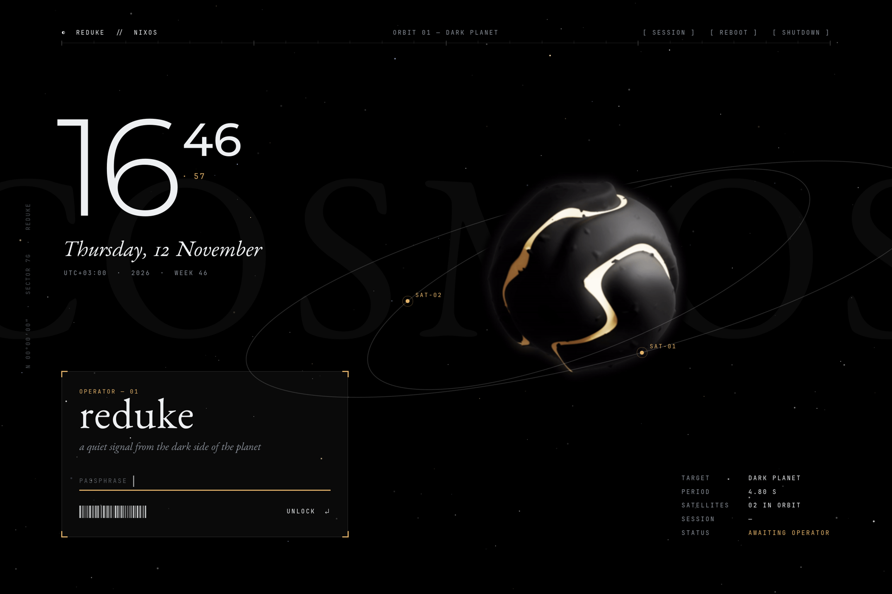

<div align="center">


# reduke

**одна тёмная планета** &middot; *from the power button to the desktop in one motion.*

NixOS и Hyprland, собранные как одна система: загрузка, вход и рабочий стол — один непрерывный кадр.<br />
NixOS and Hyprland built as one system: boot, login and desktop are a single continuous shot.

[](#where-things-are)
[](#the-desktop)
[](#the-desktop)
[](#install)

[](#what-it-is)
[](#showroom)

<kbd><a href="#showroom">Showroom</a></kbd> &middot;
<kbd><a href="#русский">Русский</a></kbd> &middot;
<kbd><a href="#english">English</a></kbd> &middot;
<kbd><a href="#установка">Установка</a></kbd> &middot;
<kbd><a href="#install">Install</a></kbd>

</div>

<br />


<a id="showroom"></a>

## Showroom

<table>
  <tr>
    <td width="50%">
      
      <br /><sub><b>Загрузка · Boot.</b> Plymouth, dark planet, 2x.</sub>
    </td>
    <td width="50%">
      
      <br /><sub><b>Вход · Login.</b> Orbit: часы, имя, телеметрия.</sub>
    </td>
  </tr>
</table>

<div align="center"><sub>Кадры отрендерены из самих тем.<br />Rendered from the themes themselves.</sub></div>

---

<a id="русский"></a>

## Русский

### Что это

Это не набор dotfiles. Это система, которую видно целиком с первой секунды.

Нажимаете кнопку — на чёрном экране поворачивается тёмная планета с золотыми прожилками. Экран входа начинается с того же кадра: та же планета, того же размера, на том же месте. Она уходит вправо, вокруг загораются звёзды и две орбиты, проявляются часы и ваше имя. После пароля планета возвращается в центр, и из неё раскрывается рабочий стол.

Дальше всё подстраивается под обои: Hyprland, Waybar, уведомления, терминал и приложения берут цвета с текущей картинки. Своя панель настроек, светлая и тёмная тема, тихая загрузка. Ставится несколькими командами, обновляется одной.

### Путь

| | Что происходит |
| --- | --- |
| **Загрузка** | Plymouth показывает `dark_planet` с фиксированным масштабом 2x вместо строк лога. |
| **Вход** | SDDM-тема Orbit начинает с того же кадра. Звёзды, падающие звёзды, две орбиты со спутниками, огромное `COSMOS` на фоне. Крупные часы с минутами в верхнем индексе, дата антиквой, карточка с именем и строкой пароля, моноширинная телеметрия. |
| **Переход** | Quickshell подхватывает картинку, которой закончился вход: планета на чёрном. Из неё раскрывается круг с золотым кольцом и открывает рабочий стол. Один раз за вход. |

<a id="the-desktop"></a>

### Рабочий стол

- **Цвета из обоев.** pywal берёт палитру с текущих обоев и перекрашивает Hyprland, Waybar, rofi, уведомления, терминал, Zathura и Telegram.
- **Светлая и тёмная тема** (`Super+Shift+Space`). Переключает GTK, Qt, Zen и Waybar, у каждой темы свои обои: `~/Wallpapers/Pictures/Light` и `~/Wallpapers/Pictures/Dark`.
- **Выбор обоев** (`Super+W`), в том числе живые видеообои.
- **Уведомления** справа сверху: карточки в стиле [rosa](https://github.com/fedyaqq34356/rosa), цвета из палитры обоев, иконки приложений.
- **Панель настроек** (`Super+I`): Wi-Fi, Bluetooth, звук, экран, диски, система.
- **Меню питания** (`Super+Esc`) и переключатель энергосбережения в Waybar.
- **Waybar**: рабочие столы, часы, CPU, GPU, память, сеть, Bluetooth, звук, батарея, раскладка, уведомления, выпадающий трей.
- **Экранные индикаторы** громкости, микрофона и яркости.
- **Жест тремя пальцами** влево/вправо переключает рабочие столы.
- **Тихая загрузка**: никаких строк лога, GRUB находит другие системы (например, Windows).
- **Обслуживание без внимания**: еженедельная очистка Nix store, zram, обновления прошивок через fwupd и GNOME Firmware.
- **Ноутбуки Huawei MateBook** с кодеком SN6140 (динамики молчат или очень тихие): добавьте `huaweiAudio = true;` в `local/settings.nix`.

<a id="установка"></a>

### Установка

Нужна установленная NixOS (x86_64, загрузка UEFI) и обычный пользователь с `sudo`.

**1. Скачайте конфиг.** Именно в `~/nixos-config`: с этой папкой работают команды `update` и `rebuild`.

```bash
nix-shell -p git --run 'git clone https://github.com/redukeee-hse/nixos-config.git ~/nixos-config'
cd ~/nixos-config
```

**2. Выберите набор приложений.** Выполните одну из команд:

| Что нужно | Команда |
| --- | --- |
| Без приложений, которым нужен VPN | `./scripts/configure-local.sh --no-vpn-apps` |
| С ними (VPN должен быть включён во время сборки) | `./scripts/configure-local.sh --vpn-apps` |
| С ними и с ChatGPT | `./scripts/configure-local.sh --vpn-apps`, затем `sed -i '$s/^}/  chatgpt = true;\n}/' local/settings.nix` |

Без флага скрипт спросит сам. Он берёт имя пользователя, хост, часовой пояс, язык, раскладку и `stateVersion` из текущей системы и записывает их в `local/settings.nix`. Перед следующим шагом загляните в этот файл.

**3. Соберите систему и перезагрузитесь.**

```bash
./scripts/rebuild.sh
reboot
```

В SDDM выберите сессию Hyprland.

> [!TIP]
> Чтобы заставка сразу шла в родном разрешении, добавьте драйвер видеокарты в `boot.initrd.kernelModules` в `local/configuration.nix`: `"i915"` для Intel, `"amdgpu"` для AMD.

### Какие приложения ставятся

| Набор | Приложения |
| --- | --- |
| **Всегда** | Zen Browser (с uBlock Origin), Telegram, VS Code, GitHub Desktop, Alacritty, Nautilus, Mission Center, OnlyOffice, Zathura (PDF, DjVu, EPUB), Loupe (картинки), mpv, File Roller и архиваторы, Happ, AmneziaVPN, Docker, Postman |
| **`vpnApps = true`** | Claude Desktop, Claude Code, Spotify, Discord, Notion, Notion Calendar |
| **`chatgpt = true`** (нужен `vpnApps`) | ChatGPT Desktop |

Приложения из второй и третьей строки заблокированы в России или не скачиваются оттуда, поэтому по умолчанию выключены.

```bash
update --vpn-apps      # добавить (включите VPN)
update --no-vpn-apps   # убрать
```

ChatGPT включается и выключается строкой `chatgpt = true;` / `false;` в `local/settings.nix`, затем `rebuild`. OpenAI публикует только ссылку на последнюю версию, поэтому сразу после её выхода сборка может упасть с hash mismatch, пока конфиг не обновится. На это время выключите `chatgpt`.

**Свои приложения** добавляйте в `local/home.nix`, например `home.packages = with pkgs; [ obsidian ];`, затем `rebuild`.

### Каждый день

| Клавиши | Действие |
| --- | --- |
| `Super+Space` | Запуск приложений (rofi) |
| `Super+Enter` / `Super+Tab` | Терминал |
| `Super+Q` | Плавающий терминал с fastfetch |
| `Super+B` | Браузер Zen |
| `Super+F` | Файловый менеджер |
| `Super+V` | VS Code в папке текущего терминала |
| `Super+R` | Закрыть окно |
| `Super+M` | Развернуть окно |
| `Super+1…0` / `Super+Shift+1…0` | Перейти на рабочий стол / перенести туда окно |
| `Super+Shift+стрелки` | Переместить окно |
| `Super+←/→` | Изменить ширину окна |
| `Super+H` / `Super+Shift+H` | Скрытый рабочий стол / убрать туда окно |
| `Super+Y` | Spotify |
| `Super+I` | Панель настроек |
| `Super+W` / `Super+Ctrl+Space` | Выбор обоев |
| `Super+Shift+Space` | Светлая/тёмная тема |
| `Super+N` | Центр уведомлений |
| `Super+T` | Трей |
| `Super+Esc` | Меню питания |
| `Super+AltGr+Esc` | Режим энергосбережения |
| `Print` / `Shift+Print` | Скриншот области / экрана в буфер |
| `Super+Print` / `Super+Shift+Print` | То же в `~/Pictures/Screenshots` |
| `Alt+Tab` | Следующее окно |

```bash
update               # скачать новую версию конфига, собрать и переключиться
update --no-switch   # только скачать; применить позже командой rebuild
rebuild              # применить изменения в local/
scripts/clean.sh     # оставить две последние конфигурации и очистить Nix store
```

### Свои настройки

Всё личное хранится в `local/`. Git её игнорирует, а `update` не трогает. Примеры лежат в `local.example/`.

| Файл | Что в нём |
| --- | --- |
| `local/settings.nix` | Имя, хост, часовой пояс, язык, раскладка, `vpnApps`, `chatgpt`, `huaweiAudio` |
| `local/configuration.nix` | Свои опции NixOS: пакеты, драйверы, загрузчик (для systemd-boot или BIOS) |
| `local/home.nix` | Свои опции Home Manager |

После правки выполните `rebuild`. Файлы репозитория лучше не трогать: `update` сохранит такие правки патчем в `local/backups/` и вернёт файлы к исходному виду. Ваши коммиты он сохраняет и переносит поверх новой версии.

### Для разработки

Go 1.27 с golangci-lint, oapi-codegen и goose, Python 3.12, gcc, cmake, Docker (запускается при первой команде `docker`) и Postman. Сервисы ниже слушают только localhost и не стартуют при загрузке:

| Команды | Что запускают |
| --- | --- |
| `redis-up` / `redis-down` | Redis на `:6379` |
| `kafka-up` / `kafka-down` | Kafka (KRaft, один узел) на `:9092` |
| `obs-up` / `obs-down` | OpenTelemetry Collector `:22318`, Grafana `:22300`, Prometheus `:22909`, Jaeger `:22686`, Loki `:3100` |

`obs-env > .env` выводит переменные `OTEL_*` для приложения. Ещё есть nginx и PostgreSQL, они запускаются вместе с системой.

### Если что-то сломалось

Выберите предыдущую конфигурацию в меню загрузки или выполните:

```bash
sudo nixos-rebuild switch --rollback
```

<details>
<summary>Ставили конфиг до появления <code>update</code>?</summary>

Старый `configure-local.sh` вписывал ваши данные прямо в файлы репозитория. Один раз выполните:

```bash
cd ~/nixos-config
git fetch origin main
git show origin/main:scripts/update.sh > /tmp/nixos-update.sh
bash /tmp/nixos-update.sh
```

Скрипт перенесёт ваши настройки в `local/`, обновит конфиг и применит его. Дальше хватит `update`.
</details>

### Где что лежит

NixOS 26.05, `x86_64-linux`, flake-выход `nixosConfigurations.example`.

| Путь | Что там |
| --- | --- |
| `local/` | Ваши настройки (не в Git), шаблоны в `local.example/` |
| `hosts/example/` | Общая конфигурация хоста |
| `modules/system/` | Nix, загрузчик и Plymouth, сеть и VPN-клиенты, локаль, пользователь, команды `update` и `rebuild` |
| `modules/hardware/` | Звук (PipeWire), Bluetooth, питание, прошивки, звук Huawei MateBook |
| `modules/desktop/` | Hyprland, SDDM с темой Orbit, шрифты |
| `modules/services/` | Docker, nginx, PostgreSQL, Happ, Redis и Kafka, стек наблюдаемости |
| `home/example/` | Home Manager: Hyprland, Waybar, Quickshell, eww, rofi, SwayNC, скрипты, приложения по умолчанию |
| `packages/` | Свои рецепты: Claude, ChatGPT, Happ, Postman, Jaeger, Go-инструменты |
| `scripts/` | `configure-local.sh`, `rebuild.sh`, `update.sh`, `clean.sh`; для правки самого конфига `update-all.sh` и `update-apps.py` |
| `tests/` | Тесты для скриптов (`python3 -m unittest discover tests`) |

Обычный `nixos-rebuild --flake .#example` не видит `local/`, потому что Git её игнорирует. Скрипты передают flake как `path:`, вручную это `sudo nixos-rebuild switch --flake path:.#example`.

---

<a id="english"></a>

## English

<a id="what-it-is"></a>

### What it is

Not a pile of dotfiles. A system you see whole from the first second.

Press the power button and a dark planet with gold veins turns on a black screen. The login screen starts on that same frame: the same planet, the same size, the same place. It drifts right, stars and two orbits light up around it, the clock and your name fade in. After the password the planet returns to the centre and the desktop opens out of it.

From there everything follows the wallpaper: Hyprland, Waybar, notifications, the terminal and apps take their colors from the current picture. Its own settings panel, light and dark modes, a quiet boot. Installs with a few commands, updates with one.

### The journey

| | What happens |
| --- | --- |
| **Boot** | Plymouth plays `dark_planet` at a fixed 2x scale instead of log lines. |
| **Login** | The Orbit SDDM theme starts on the same frame. Stars, shooting stars, two orbits with satellites, a huge ghosted `COSMOS`. A large clock with superscript minutes, a serif date, a name card with the password line, mono telemetry. |
| **Reveal** | Quickshell picks up the picture the login ends on, the planet on black. A circle with a gold ring opens from it and uncovers the desktop. Once per login. |

### The desktop

- **Colors from the wallpaper.** pywal takes the palette from the current wallpaper and recolors Hyprland, Waybar, rofi, notifications, the terminal, Zathura, and Telegram.
- **Light and dark mode** (`Super+Shift+Space`). Switches GTK, Qt, Zen, and Waybar; each mode has its own wallpapers in `~/Wallpapers/Pictures/Light` and `~/Wallpapers/Pictures/Dark`.
- **Wallpaper picker** (`Super+W`), including live video wallpapers.
- **Notifications** in the top right: cards styled after [rosa](https://github.com/fedyaqq34356/rosa), colored from the wallpaper palette, with app icons.
- **Settings panel** (`Super+I`): Wi-Fi, Bluetooth, sound, display, storage, system.
- **Power menu** (`Super+Esc`) and a power-saver toggle in Waybar.
- **Waybar**: workspaces, clock, CPU, GPU, memory, network, Bluetooth, sound, battery, keyboard layout, notifications, drop-down tray.
- **On-screen indicators** for volume, microphone, and brightness.
- **Three-finger swipe** left/right switches workspaces.
- **Quiet boot**: no log lines; GRUB finds other systems (e.g. Windows).
- **Low maintenance**: weekly Nix store cleanup, zram, firmware updates through fwupd and GNOME Firmware.
- **Huawei MateBook** with the SN6140 codec (speakers silent or very quiet): add `huaweiAudio = true;` to `local/settings.nix`.

<a id="install"></a>

### Install

You need an installed NixOS (x86_64, UEFI boot) and a regular user with `sudo`.

**1. Download the config.** Clone into `~/nixos-config` exactly: the `update` and `rebuild` commands use that folder.

```bash
nix-shell -p git --run 'git clone https://github.com/redukeee-hse/nixos-config.git ~/nixos-config'
cd ~/nixos-config
```

**2. Pick the app set.** Run one of these:

| You want | Command |
| --- | --- |
| No apps that need a VPN in Russia | `./scripts/configure-local.sh --no-vpn-apps` |
| With them (in Russia, keep a VPN on during the build) | `./scripts/configure-local.sh --vpn-apps` |
| With them and ChatGPT | `./scripts/configure-local.sh --vpn-apps`, then `sed -i '$s/^}/  chatgpt = true;\n}/' local/settings.nix` |

Outside Russia, just pick `--vpn-apps`. Without a flag the script asks. It reads your username, hostname, time zone, language, keyboard layout, and `stateVersion` from the running system and writes them to `local/settings.nix`. Check that file before the next step.

**3. Build and reboot.**

```bash
./scripts/rebuild.sh
reboot
```

Pick the Hyprland session in SDDM.

> [!TIP]
> For the splash to start at native resolution right away, add your GPU driver to `boot.initrd.kernelModules` in `local/configuration.nix`: `"i915"` for Intel, `"amdgpu"` for AMD.

### Which apps get installed

| Set | Apps |
| --- | --- |
| **Always** | Zen Browser (with uBlock Origin), Telegram, VS Code, GitHub Desktop, Alacritty, Nautilus, Mission Center, OnlyOffice, Zathura (PDF, DjVu, EPUB), Loupe (images), mpv, File Roller and archivers, Happ, AmneziaVPN, Docker, Postman |
| **`vpnApps = true`** | Claude Desktop, Claude Code, Spotify, Discord, Notion, Notion Calendar |
| **`chatgpt = true`** (needs `vpnApps`) | ChatGPT Desktop |

The second and third rows are blocked in Russia or can't be downloaded from there, so they are off by default.

```bash
update --vpn-apps      # add them (turn the VPN on)
update --no-vpn-apps   # remove them
```

ChatGPT is switched with `chatgpt = true;` / `false;` in `local/settings.nix`, then `rebuild`. OpenAI only publishes a link to the latest release, so right after a new one the build can fail with a hash mismatch until the config catches up. Turn `chatgpt` off meanwhile.

**Your own apps** go into `local/home.nix`, e.g. `home.packages = with pkgs; [ obsidian ];`, then `rebuild`.

### Day to day

| Keys | Action |
| --- | --- |
| `Super+Space` | App launcher (rofi) |
| `Super+Enter` / `Super+Tab` | Terminal |
| `Super+Q` | Floating terminal with fastfetch |
| `Super+B` | Zen browser |
| `Super+F` | File manager |
| `Super+V` | VS Code in the current terminal's folder |
| `Super+R` | Close window |
| `Super+M` | Maximize window |
| `Super+1…0` / `Super+Shift+1…0` | Go to workspace / move window there |
| `Super+Shift+arrows` | Move window |
| `Super+←/→` | Resize window width |
| `Super+H` / `Super+Shift+H` | Hidden workspace / move window there |
| `Super+Y` | Spotify |
| `Super+I` | Settings panel |
| `Super+W` / `Super+Ctrl+Space` | Wallpaper picker |
| `Super+Shift+Space` | Light/dark mode |
| `Super+N` | Notification center |
| `Super+T` | Tray |
| `Super+Esc` | Power menu |
| `Super+AltGr+Esc` | Power-saver mode |
| `Print` / `Shift+Print` | Screenshot of an area / the screen to the clipboard |
| `Super+Print` / `Super+Shift+Print` | Same, saved to `~/Pictures/Screenshots` |
| `Alt+Tab` | Next window |

```bash
update               # download the new config version, build, and switch
update --no-switch   # only download; apply later with rebuild
rebuild              # apply your edits to local/
scripts/clean.sh     # keep the last two generations and clean the Nix store
```

### Your own settings

Everything personal lives in `local/`, which Git ignores and `update` never touches. Examples are in `local.example/`.

| File | What it holds |
| --- | --- |
| `local/settings.nix` | Username, hostname, time zone, language, keyboard layout, `vpnApps`, `chatgpt`, `huaweiAudio` |
| `local/configuration.nix` | Your own NixOS options: packages, drivers, bootloader (for systemd-boot or BIOS) |
| `local/home.nix` | Your own Home Manager options |

Run `rebuild` after editing. Avoid editing tracked files: `update` saves such edits as a patch in `local/backups/` and reverts them. Your own commits are kept and replayed on top of the new version.

### For development

Go 1.27 with golangci-lint, oapi-codegen, and goose, Python 3.12, gcc, cmake, Docker (starts on the first `docker` command), and Postman. The services below listen on localhost only and don't start at boot:

| Commands | What they start |
| --- | --- |
| `redis-up` / `redis-down` | Redis on `:6379` |
| `kafka-up` / `kafka-down` | Kafka (KRaft, single node) on `:9092` |
| `obs-up` / `obs-down` | OpenTelemetry Collector `:22318`, Grafana `:22300`, Prometheus `:22909`, Jaeger `:22686`, Loki `:3100` |

`obs-env > .env` prints the `OTEL_*` variables for your app. nginx and PostgreSQL are there too and start with the system.

### If something breaks

Pick the previous generation in the boot menu, or run:

```bash
sudo nixos-rebuild switch --rollback
```

<details>
<summary>Installed before <code>update</code> existed?</summary>

The old `configure-local.sh` wrote your details straight into tracked files. Run this once:

```bash
cd ~/nixos-config
git fetch origin main
git show origin/main:scripts/update.sh > /tmp/nixos-update.sh
bash /tmp/nixos-update.sh
```

It moves your settings into `local/`, updates the config, and applies it. After that, `update` is all you need.
</details>

<a id="where-things-are"></a>

### Where things are

NixOS 26.05, `x86_64-linux`, flake output `nixosConfigurations.example`.

| Path | What's there |
| --- | --- |
| `local/` | Your settings (not in Git); templates in `local.example/` |
| `hosts/example/` | The shared host configuration |
| `modules/system/` | Nix, bootloader and Plymouth, networking and VPN clients, locale, the user account, the `update`/`rebuild` commands |
| `modules/hardware/` | Sound (PipeWire), Bluetooth, power management, firmware, Huawei MateBook audio |
| `modules/desktop/` | Hyprland, SDDM with the Orbit theme, fonts |
| `modules/services/` | Docker, nginx, PostgreSQL, Happ, Redis and Kafka, the observability stack |
| `home/example/` | Home Manager: Hyprland, Waybar, Quickshell, eww, rofi, SwayNC, scripts, default apps |
| `packages/` | Own recipes: Claude, ChatGPT, Happ, Postman, Jaeger, Go tools |
| `scripts/` | `configure-local.sh`, `rebuild.sh`, `update.sh`, `clean.sh`; for working on the config itself, `update-all.sh` and `update-apps.py` |
| `tests/` | Tests for the scripts (`python3 -m unittest discover tests`) |

A plain `nixos-rebuild --flake .#example` can't see `local/` because Git ignores it. The scripts pass the flake as `path:`; by hand that is `sudo nixos-rebuild switch --flake path:.#example`.

---

## Credits · Благодарности

The planet frames are [dark_planet](https://github.com/adi1090x/plymouth-themes) by Aditya Shakya (adi1090x). The notification cards follow [rosa](https://github.com/fedyaqq34356/rosa). The settings panel and power menu are adapted from [43PR/dotfiles](https://github.com/43PR/dotfiles) (MIT). The way this page presents the system owes a lot to [Ryoku](https://github.com/Ryoku-dev/ryoku). Built on [NixOS](https://nixos.org), [Hyprland](https://hypr.land), [Quickshell](https://quickshell.org), [pywal](https://github.com/dylanaraps/pywal) and awww; set in [Montserrat](https://github.com/JulietaUla/Montserrat), [EB Garamond](https://github.com/octaviopardo/EBGaramond12), Inter and JetBrains Mono.
