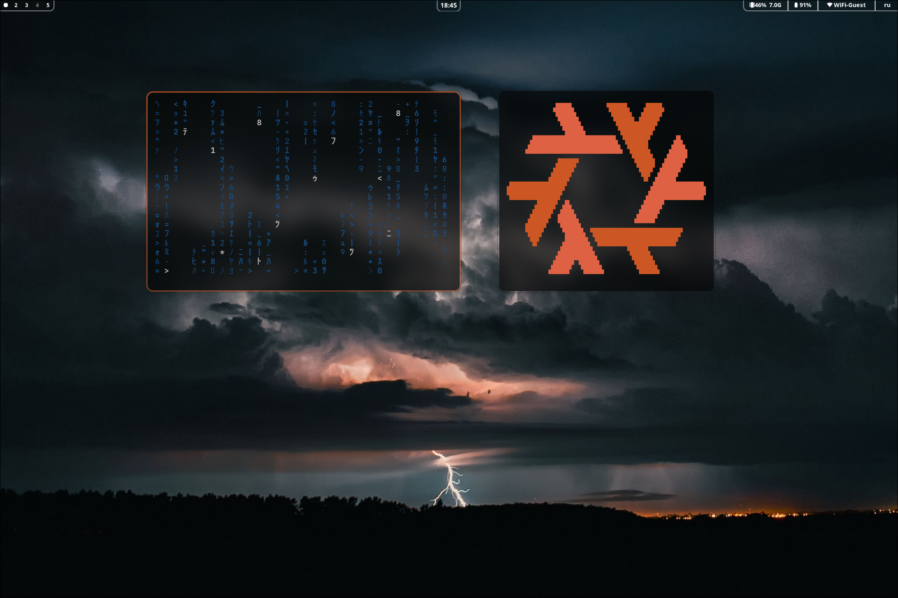
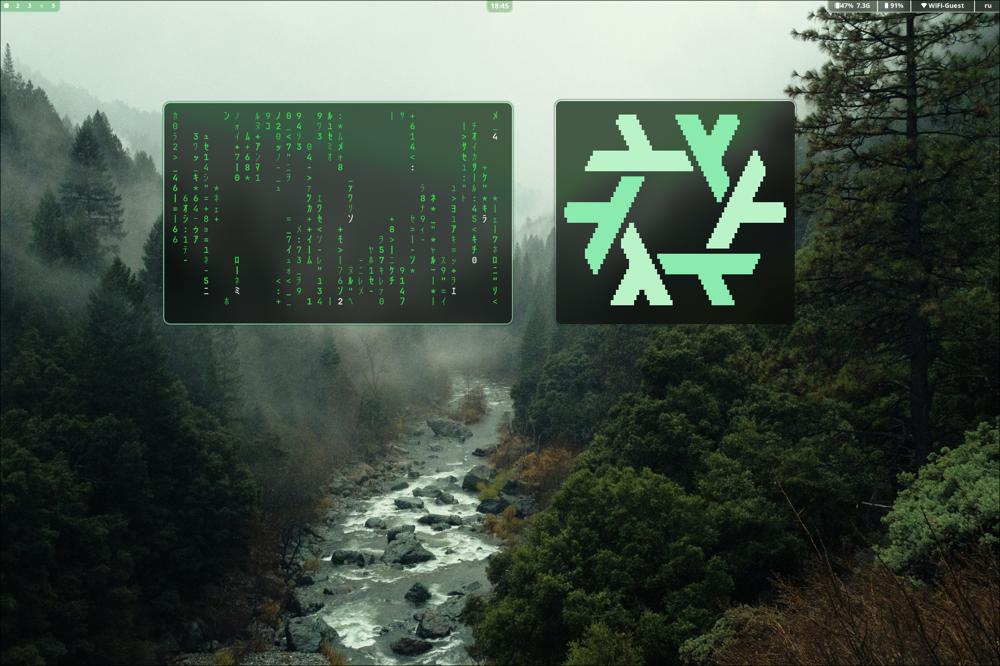
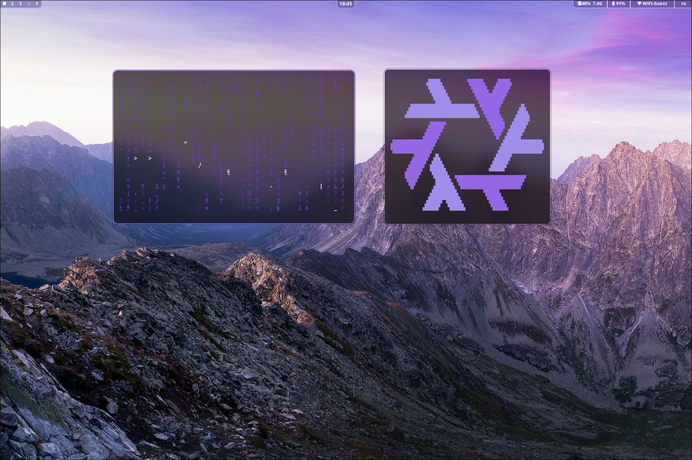

[Русский](#русский) · [English](#english)

# NixOS + Hyprland

Мой конфиг NixOS с Hyprland: красивый и удобный рабочий стол, который ставится несколькими командами.

My NixOS configuration with Hyprland: a good-looking, comfortable desktop that installs with a few commands.

| Гроза / Storm | Лес / Forest | Горы / Mountains |
| :---: | :---: | :---: |
| [](docs/screenshots/storm.png) | [](docs/screenshots/forest.png) | [](docs/screenshots/mountains.png) |

## Русский

### Установка

Нужна установленная NixOS (x86_64) и обычный пользователь с `sudo`. Выполните в терминале:

```bash
nix-shell -p git --run 'git clone https://github.com/redukeee-hse/nixos-config.git ~/nixos-config'
cd ~/nixos-config
./scripts/configure-local.sh
./scripts/rebuild.sh
reboot
```

После перезагрузки выберите в SDDM сессию Hyprland.

- `configure-local.sh` берёт имя пользователя, хост, часовой пояс, язык, раскладку и `stateVersion` из текущей системы и записывает их в `local/settings.nix`. Перед `rebuild.sh` загляните в этот файл.
- Скрипт спросит, ставить ли **приложения, которым в России нужен VPN**: Claude Desktop, Claude Code, Spotify, Discord, Notion и Notion Calendar. Отвечайте «да», только если VPN будет включён во время сборки. Иначе поставите их позже командой `update --vpn-apps`.
- Клонируйте именно в `~/nixos-config`: команды `update` и `rebuild` работают с этой папкой.
- Конфиг использует GRUB в режиме UEFI. Для systemd-boot или BIOS переопределите загрузчик в `local/configuration.nix`.

### Обновление

```bash
update
```

Скачивает последнюю версию конфига, собирает систему и переключается на неё. Ваша папка `local/` не меняется.

```bash
update --vpn-apps      # добавить приложения, которым нужен VPN (включите VPN)
update --no-vpn-apps   # убрать их
update --no-switch     # только скачать, применить позже командой rebuild
rebuild                # применить изменения после правки local/
```

### Свои настройки

Всё личное хранится в `local/`. Git её игнорирует, а `update` не трогает. Примеры лежат в `local.example/`.

- `local/settings.nix` — имя, хост, язык, раскладка, `vpnApps`.
- `local/configuration.nix` — свои опции NixOS (пакеты, драйверы).
- `local/home.nix` — свои опции Home Manager.

Файлы репозитория лучше не править: `update` сохранит такие правки патчем в `local/backups/` и вернёт файлы к исходному виду. Ваши коммиты он сохраняет и переносит поверх новой версии.

ChatGPT для Linux включается строкой `chatgpt = true;` в `local/settings.nix` (нужен включённый `vpnApps`). OpenAI отдаёт только ссылку на последнюю версию, поэтому сразу после её выхода сборка может упасть с hash mismatch, пока конфиг не обновится; на это время выключите `chatgpt`.

Для ноутбуков Huawei MateBook с кодеком SN6140 (динамики молчат или очень тихие) добавьте `huaweiAudio = true;`.

### Рабочий стол

- `Super+Shift+Space` — светлая/тёмная тема. Обои для каждой берутся из `~/Wallpapers/Pictures/Light` и `~/Wallpapers/Pictures/Dark`, Waybar, GTK, Qt, Zen и Telegram перекрашиваются следом.
- Три пальца влево/вправо на тачпаде — переключение рабочих столов.
- `redis-up`/`kafka-up` и `obs-up` запускают Redis, Kafka и стек наблюдаемости (OpenTelemetry Collector, Prometheus, Grafana, Loki, Jaeger) на localhost; `*-down` останавливает. При загрузке они не стартуют.
- AmneziaVPN и `awg-quick` для туннелей AmneziaWG.

### Обслуживание

```bash
scripts/clean.sh        # оставить две последние конфигурации и очистить Nix store
```

Для тех, кто правит сам конфиг: `scripts/update-all.sh` обновляет flake, рецепты из `packages/` (`scripts/update-apps.py`), пересобирает систему и ставит прошивки через fwupd. С `--check` только показывает, что устарело. Он меняет файлы репозитория, так что обычным пользователям хватит `update`.

### Если что-то сломалось

Выберите предыдущее поколение в меню загрузки или выполните:

```bash
sudo nixos-rebuild switch --rollback
```

<details>
<summary>Ставили конфиг до появления <code>update</code>?</summary>

Старый `configure-local.sh` вписывал ваши данные прямо в файлы репозитория. Один раз выполните:

```bash
cd ~/nixos-config
git fetch origin main
git show origin/main:scripts/update.sh > /tmp/nixos-update.sh
bash /tmp/nixos-update.sh
```

Скрипт перенесёт ваши настройки в `local/`, обновит конфиг и применит его. Дальше хватит `update`.
</details>

<details>
<summary>Что внутри</summary>

NixOS 26.05, `x86_64-linux`, flake-выход `nixosConfigurations.example`.

- `local/` — ваши настройки (не в Git), шаблоны в `local.example/`.
- `hosts/example/` — общая конфигурация хоста.
- `modules/system/` — Nix, загрузчик и Plymouth, сеть, локаль, пользователь, команды `update` и `rebuild`.
- `modules/hardware/` — звук (PipeWire), Bluetooth, питание, прошивки (fwupd), звук Huawei MateBook.
- `modules/desktop/` — Hyprland, SDDM со своей темой, шрифты.
- `modules/services/` — Docker, nginx, PostgreSQL, Happ, Redis и Kafka, стек наблюдаемости.
- `home/example/` — Home Manager, оформление рабочего стола и программы по умолчанию для документов, PDF, картинок, видео и архивов.
- `packages/` — локальные пакеты.
- `scripts/` — `configure-local.sh`, `rebuild.sh`, `update.sh`, `clean.sh`, `update-all.sh`, `update-apps.py`.
- `tests/` — тесты для скриптов (`python3 -m unittest discover tests`).

Обычный `nixos-rebuild --flake .#example` не видит `local/`, потому что Git её игнорирует. Скрипты передают flake как `path:`, вручную это `sudo nixos-rebuild switch --flake path:.#example`.
</details>

## English

### Installation

You need an installed NixOS (x86_64) and a regular user with `sudo`. Run:

```bash
nix-shell -p git --run 'git clone https://github.com/redukeee-hse/nixos-config.git ~/nixos-config'
cd ~/nixos-config
./scripts/configure-local.sh
./scripts/rebuild.sh
reboot
```

After the reboot, pick the Hyprland session in SDDM.

- `configure-local.sh` reads your username, hostname, time zone, language, keyboard layout, and `stateVersion` from the running system and writes them to `local/settings.nix`. Check that file before running `rebuild.sh`.
- The script asks whether to install the **apps that need a VPN in Russia**: Claude Desktop, Claude Code, Spotify, Discord, Notion, and Notion Calendar. Outside Russia, just answer yes. In Russia, answer yes only if your VPN is on during the build; otherwise add them later with `update --vpn-apps`.
- Clone into `~/nixos-config` exactly: the `update` and `rebuild` commands use that folder.
- The config boots with GRUB in UEFI mode. For systemd-boot or BIOS, override the bootloader in `local/configuration.nix`.

### Updating

```bash
update
```

Downloads the latest version of the config, builds the system, and switches to it. Your `local/` folder is left as it is.

```bash
update --vpn-apps      # add the apps that need a VPN (turn the VPN on)
update --no-vpn-apps   # remove them
update --no-switch     # only download; apply later with rebuild
rebuild                # apply your edits to local/
```

### Your own settings

Everything personal lives in `local/`, which Git ignores and `update` never touches. Examples are in `local.example/`.

- `local/settings.nix`: username, hostname, language, keyboard layout, `vpnApps`.
- `local/configuration.nix`: your own NixOS options (packages, drivers).
- `local/home.nix`: your own Home Manager options.

Avoid editing tracked files: `update` saves such edits as a patch in `local/backups/` and reverts them. Your own commits are kept and replayed on top of the new version.

To install the ChatGPT desktop app, add `chatgpt = true;` to `local/settings.nix` (it needs `vpnApps` on). OpenAI only publishes a link to the latest release, so right after a new one the build can fail with a hash mismatch until the config catches up; turn `chatgpt` off meanwhile.

On a Huawei MateBook with the SN6140 codec (speakers silent or very quiet), add `huaweiAudio = true;`.

### Desktop

- `Super+Shift+Space` switches between light and dark mode. Each mode has its own wallpapers in `~/Wallpapers/Pictures/Light` and `~/Wallpapers/Pictures/Dark`; Waybar, GTK, Qt, Zen, and Telegram follow.
- Three-finger horizontal swipe on the touchpad switches workspaces.
- `redis-up`/`kafka-up` and `obs-up` start Redis, Kafka, and an observability stack (OpenTelemetry Collector, Prometheus, Grafana, Loki, Jaeger) on localhost; `*-down` stops them. None of them start at boot.
- AmneziaVPN, plus `awg-quick` for AmneziaWG tunnels.

### Maintenance

```bash
scripts/clean.sh        # keep the last two generations and clean the Nix store
```

If you work on the config itself, `scripts/update-all.sh` updates the flake inputs and the recipes in `packages/` (`scripts/update-apps.py`), rebuilds, and installs firmware updates through fwupd. `--check` only shows what is outdated. It edits tracked files, so if you just use the config, `update` is all you need.

### If something breaks

Pick the previous generation in the boot menu, or run:

```bash
sudo nixos-rebuild switch --rollback
```

<details>
<summary>Installed before <code>update</code> existed?</summary>

The old `configure-local.sh` wrote your details straight into tracked files. Run this once:

```bash
cd ~/nixos-config
git fetch origin main
git show origin/main:scripts/update.sh > /tmp/nixos-update.sh
bash /tmp/nixos-update.sh
```

It moves your settings into `local/`, updates the config, and applies it. After that, `update` is all you need.
</details>

<details>
<summary>What's inside</summary>

NixOS 26.05, `x86_64-linux`, flake output `nixosConfigurations.example`.

- `local/`: your settings (not in Git); templates in `local.example/`.
- `hosts/example/`: the shared host configuration.
- `modules/system/`: Nix, bootloader and Plymouth, networking, locale, the user account, and the `update`/`rebuild` commands.
- `modules/hardware/`: sound (PipeWire), Bluetooth, power management, firmware updates (fwupd), Huawei MateBook audio.
- `modules/desktop/`: Hyprland, SDDM with a custom theme, fonts.
- `modules/services/`: Docker, nginx, PostgreSQL, Happ, Redis and Kafka, the observability stack.
- `home/example/`: Home Manager, desktop styling and default apps for documents, PDF, images, video and archives.
- `packages/`: local packages.
- `scripts/`: `configure-local.sh`, `rebuild.sh`, `update.sh`, `clean.sh`, `update-all.sh`, `update-apps.py`.
- `tests/`: tests for the scripts (`python3 -m unittest discover tests`).

A plain `nixos-rebuild --flake .#example` can't see `local/` because Git ignores it. The scripts pass the flake as `path:`; by hand that is `sudo nixos-rebuild switch --flake path:.#example`.
</details>
